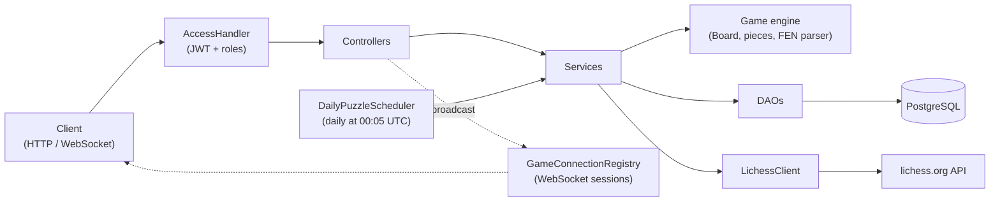
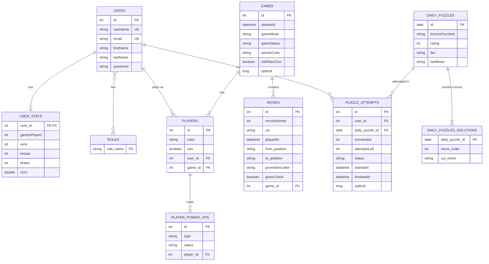

# Chess Backend API

## Vision

This project is a backend REST API for playing chess online, built around a chess engine written from scratch.
Two registered players can play a full game of classic chess against each other with live updates over WebSocket, track their win/loss statistics, and solve the Lichess daily puzzle move by move.

---

## Links

Portfolio website:
<LINK>

Project overview video (max 5 min):
<LINK>

Deployed application (optional):
<LINK>

Source code repository:
<LINK>

---

# Architecture

## System Overview

The project is built as a layered backend architecture:

- **Controller layer** – Javalin endpoint groups (`GameController`, `DailyPuzzleController`, `UserController`, `AuthController`, `GameSocketController`). They validate input, read the logged-in user from the token, and return DTOs as JSON.
- **Service layer** – business logic (`GameService`, `DailyPuzzleService`, `UserService`, `TokenService`). Services rebuild boards, validate moves, decide game results and update statistics.
- **DAO layer** – database access with JPA/Hibernate (`GameDAO`, `DailyPuzzleDAO`, `DailyPuzzleAttemptDAO`, `UserStatsDAO`, …).
- **Game engine** – plain Java, no framework dependencies: board, pieces, move generation, check/checkmate/stalemate detection, castling, en passant, promotion and a FEN parser.
- **Clients** – HTTP clients for external APIs (Lichess, Chess.com).
- **Scheduler** – a background job that fetches the Lichess daily puzzle once a day.

Technologies used:

- Java 25
- Javalin 7 (REST + WebSocket)
- JPA / Hibernate 7
- PostgreSQL
- Maven
- JWT authentication (java-jwt) and BCrypt password hashing (jBCrypt)
- Jackson (JSON)
- Lombok
- JUnit, Hamcrest, REST Assured and Testcontainers for testing

---

## Architecture Diagram



---

## Key Design Decisions

**Authentication and authorisation**

Users register and log in to receive a JWT. Every route declares the roles allowed to use it (`ANYONE`, `USER`, `ADMIN`), and an `AccessHandler` runs before each matched route, verifies the token and checks the roles. On top of that, the services check ownership: only the player of a colour can move or resign for that colour. Passwords are stored hashed with BCrypt.

**The board is rebuilt from the move history**

The board itself is never stored. A game only stores its list of moves, and `ReplayHelper` rebuilds the board by replaying them on every request. This keeps the database simple and makes the move history the single source of truth. The same idea is used for puzzles: the board is rebuilt from the puzzle's FEN plus the solution moves played so far.

**FEN parser**

Lichess puzzles start from a position, not from the opening, so the engine has a `FenParser` that builds a board from a FEN string. FEN does not store whether pieces have moved, so the parser derives this: pawns from their rank, kings and rooks from the castling field, and en passant from the en passant field.

**Concurrency**

- *Simultaneous moves:* `Game` and `DailyPuzzleAttempt` use optimistic locking (`@Version`). If two requests change the same row at the same time, only the first save wins and the other one gets **409 Conflict** instead of corrupting the game.
- *The daily puzzle race:* the puzzle's primary key is its date. If several requests try to fetch and save today's puzzle at the same moment, the database accepts one insert; the others catch the duplicate-key error and read the saved puzzle instead. All requests get the same puzzle and nobody gets an error.
- *One attempt per user:* a unique constraint on `(user_id, daily_puzzle_id)` stops a double-clicked first move from creating two attempts.
- *Scheduled prefetch:* a `ScheduledExecutorService` fetches the daily puzzle at startup and every day at 00:05 UTC, so normally no user request has to wait for Lichess. Errors inside the job are caught, so one failed night does not stop the schedule.

**External data (Lichess)**

Data from Lichess is validated before it is saved (the puzzle must have a solution and a FEN the parser accepts). Problems on Lichess's side – no response, a non-200 status, or invalid data – return **502 Bad Gateway**, not 400, because the client's request was fine. "Today" is always taken from an injected UTC `Clock`, so all parts of the system agree on the date and tests can fix the date.

**Error handling**

All expected errors are thrown as `ApiException(statusCode, message)`. A central `ExceptionHandler` turns them into JSON of the form `{"error": "..."}` with the right status code. Validation errors give 400, optimistic locking conflicts give 409, and anything unexpected is logged and returned as a generic 500.

**Testability**

`ApplicationConfig` has a second constructor that takes the `Clock` and the `LichessClient` from outside (dependency injection). The endpoint tests use it to pass a fixed clock and a fake Lichess client, so they never call the real Lichess API and the date is always the same.

---

# Data Model

## ERD



---

## Important Entities

### User

A registered user. Every user gets a `UserStats` row when registering.

Fields: id, username (unique), email (unique), firstName, lastName, password (BCrypt hash), roles

### UserStats

Win/loss statistics for a user, updated automatically when a game ends by checkmate, stalemate or resignation.

Fields: id (same as the user id), gamesPlayed, wins, losses, draws, mmr

### Game

A chess game. The board is not stored; it is rebuilt from the moves.

Fields: id, startedAt, gameMode (`CLASSIC`, `FUN`, `TRAINING`), gameStatus (`IN_PROGRESS`, `CHECKMATE`, `DRAW`, `RESIGNED`), winnerColor (`WHITE`, `BLACK`, `NO_COLOR`), isWhitesTurn, version

### Player

Connects a user (or an AI) to a game with a colour.

Fields: id, color, isAi, user, game

### Move

One move in a game, stored in UCI format (e.g. `e2e4`, `e7e8q`).

Fields: id, moveNumber, uci, playedAt, from, to, promotionLetter, givesCheck, game

### DailyPuzzle

The Lichess daily puzzle, saved once per day with the date as primary key.

Fields: id (date), lichessPuzzleId, rating, fen, lastMove, solution (ordered list of UCI moves)

### DailyPuzzleAttempt

A user's progress on one daily puzzle. A user has at most one attempt per puzzle and 10 tries.

Fields: id, user, dailyPuzzle, moveIndex, attemptsLeft, status (`IN_PROGRESS`, `SOLVED`, `FAILED`), startedAt, finishedAt, version

---

# API Documentation

All endpoints are under `/api/v1`. Protected endpoints need the header `Authorization: Bearer <token>`. Errors are returned as `{"error": "message"}`.


## Authentication

| Method | Path | Role | Description |
|---|---|---|---|
| POST | `/auth/register` | anyone | Create an account |
| POST | `/auth/login` | anyone | Log in and receive a JWT |
| GET | `/auth/healthcheck` | anyone | Check that the API is running |

## Users


| Method | Path | Role | Description |
|---|---|---|---|
| GET | `/users` | anyone | List users |
| GET | `/users/{id}` | anyone | Get one user |
| GET | `/users/username/{username}` | anyone | Find a user by username |
| GET | `/users/{id}/stats` | user | Get a user's statistics |
| PUT | `/users/{id}` | user, admin | Update a user |
| DELETE | `/users/{id}` | admin | Delete a user |

## Games

| Method | Path | Role | Description |
|---|---|---|---|
| POST | `/games` | user | Start a new game |
| GET | `/games` | user | List games |
| GET | `/games/{id}` | user | Get one game |
| DELETE | `/games/{id}` | admin | Delete a game |
| GET | `/games/{id}/moves` | user | Get the move history |
| POST | `/games/{id}/moves` | user | Make a move |
| POST | `/games/{id}/resign` | user | Resign the game |
| WS | `/games/{id}/ws?token=<jwt>` | user | Live updates for a game |


## Puzzles

| Method | Path | Role | Description |
|---|---|---|---|
| GET | `/puzzles/daily` | user, admin | Get today's Lichess puzzle |
| POST | `/puzzles/daily/moves` | user | Play a move in today's puzzle |


## Example Endpoints

### Register

```
POST /api/v1/auth/register
```

Request body:

```json
{
  "username": "sheriffen",
  "firstName": "Morten",
  "lastName": "Helander",
  "email": "morten@example.com",
  "password": "password123",
  "passwordCheck": "password123"
}
```

Response:

```
201 Created
```

### Log in

```
POST /api/v1/auth/login
```

Request body:

```json
{ "username": "sheriffen", "password": "password123" }
```

Response:

```json
{ "id": 1, "username": "sheriffen", "token": "eyJhbGciOi...", "roles": ["USER"] }
```

### Start a game

```
POST /api/v1/games
```

Request body:

```json
{ "whiteUserId": 1, "blackUserId": 2, "gameMode": "CLASSIC" }
```

Response: `201 Created` with the game, including its id, status, whose turn it is and the players.

### Make a move

```
POST /api/v1/games/{id}/moves
```

Request body (`promotionLetter` is only needed when a pawn promotes: `q`, `r`, `b` or `n`):

```json
{ "from": "e2", "to": "e4", "promotionLetter": null }
```

Response:

```json
{
  "id": 1,
  "moveNumber": 1,
  "uci": "e2e4",
  "playedAt": "2026-10-26T14:30:00.123456",
  "from": "E2",
  "to": "E4",
  "givesCheck": false
}
```

Errors: `400` illegal move, not your turn or game finished · `403` not a player in this game · `409` another move was saved at the same time.

After a successful move, every WebSocket connection to the game receives the move.

### Resign

```
POST /api/v1/games/{id}/resign
```

Response: `200 OK` with the game, where `gameStatus` is `RESIGNED` and `winnerColor` is the opponent. Both players' statistics are updated.

### Get today's puzzle

```
GET /api/v1/puzzles/daily
```

Response (the solution is never sent):

```json
{
  "date": "2026-10-22",
  "fen": "2r1b3/1p2kpQ1/p3p3/4r3/3R4/P2B4/1P3PPP/2R3K1 b - - 0 1",
  "rating": 1964,
  "lastMove": "a1c1",
  "isWhitesTurn": false,
  "movesToSolve": 5
}
```

Errors: `502` if Lichess cannot be reached or sends invalid data.

### Play a puzzle move

```
POST /api/v1/puzzles/daily/moves
```

Request body:

```json
{ "from": "c8", "to": "c1" }
```

Response:

```json
{ "isCorrect": true, "opponentMove": "d3f1", "status": "IN_PROGRESS", "attemptsLeft": 10, "movesLeft": 4 }
```

A correct move is answered with the opponent's reply. A legal but wrong move costs one try; after 10 wrong moves the attempt is `FAILED`. Any checkmate is accepted as a solution. Illegal moves return `400` and do not cost a try.

### WebSocket

```
ws://<host>/api/v1/games/{id}/ws?token=<jwt>
```

Messages from the server have the form `{"type": "...", "payload": ...}`. Current types: `PLAYER_JOINED`, `Move_MADE` and `GAME_RESIGNED`.

---

# User Stories

The full list, with acceptance criteria, priorities and status, is kept in the project's user story document. The most important ones:

**Classic chess rules**

- As a player, I want each piece to move according to the rules, so that the game is real chess. *(done)*
- As a player, I want moves that leave my king in check to be rejected. *(done)*
- As a player, I want to castle, capture en passant and choose my promotion piece. *(done)*
- As a player, I want the game to end at checkmate or stalemate. *(done)*
- As a player, I want to be told when a move gives check. *(done)*

**Game lifecycle**

- As a player, I want to start a new game. *(done)*
- As a player, I want to resign, so that I can end a lost game. *(done)*
- As a player, I want to see all moves of a game in order. *(done)*
- As a player, I want to fetch the current board as FEN. *(in progress)*

**Real-time play**

- As a player, I want my move to show up on my opponent's screen right away. *(done)*
- As a developer, I want two moves sent at the same moment to be handled safely. *(done)*
- As a player, I want both of us to be notified when the game ends. *(in progress)*

**Users**

- As a visitor, I want to create an account. *(done)*
- As a registered user, I want to log in and receive a token. *(done)*
- As a player, I want only myself to be able to move my pieces. *(done)*
- As a registered user, I want to see my wins, losses and draws. *(done)*

**External APIs**

- As a player, I want to solve the Lichess daily puzzle, so that I can practise between games. *(done)*

---

# Development Notes

**Rethinking the project.** The project started as a chess engine. To meet the course requirements (a REST API with concurrency and data integration) it was rebuilt around the engine as a layered Javalin API, with the engine kept free of framework code.

**Parsing FEN.** FEN describes a position but not its history, so information the engine depends on – whether a pawn, king or rook has moved – had to be derived from the position and the castling and en passant fields. The parser validates every part and returns 400 with a clear message for invalid input. A round of unit tests covers the start position, real puzzle positions, en passant and invalid input.

**Concurrency in practice.** The daily puzzle feature showed three different concurrency problems: many requests fetching the same puzzle (solved with the primary key and duplicate-key handling), a double-clicked first move (unique constraint), and two moves on the same attempt (optimistic locking). Each one is covered by a test that sends parallel requests.

**Exceptions wrap exceptions.** Hibernate often wraps the real cause (for example a unique constraint violation or an optimistic lock failure) inside other exceptions. Small helper methods walk the cause chain, so a duplicate key becomes 409 and a version conflict becomes 409 instead of a generic 500.

**Testing an external API.** Calling the real Lichess API in tests would make them slow and give a different puzzle every day. Injecting a fake client and a fixed `Clock` made the tests repeatable, and made it possible to test failure cases like "Lichess is down" or "Lichess sends an invalid FEN".

**A lesson from a bug.** A small helper that converts the puzzle solution to moves accidentally returned an empty list, which made every puzzle fail on its second move. The endpoint tests caught it, but the cause was found quickly only after writing a small unit test for the helper on its own. Testing small building blocks directly makes bugs much easier to locate than testing only through the API.